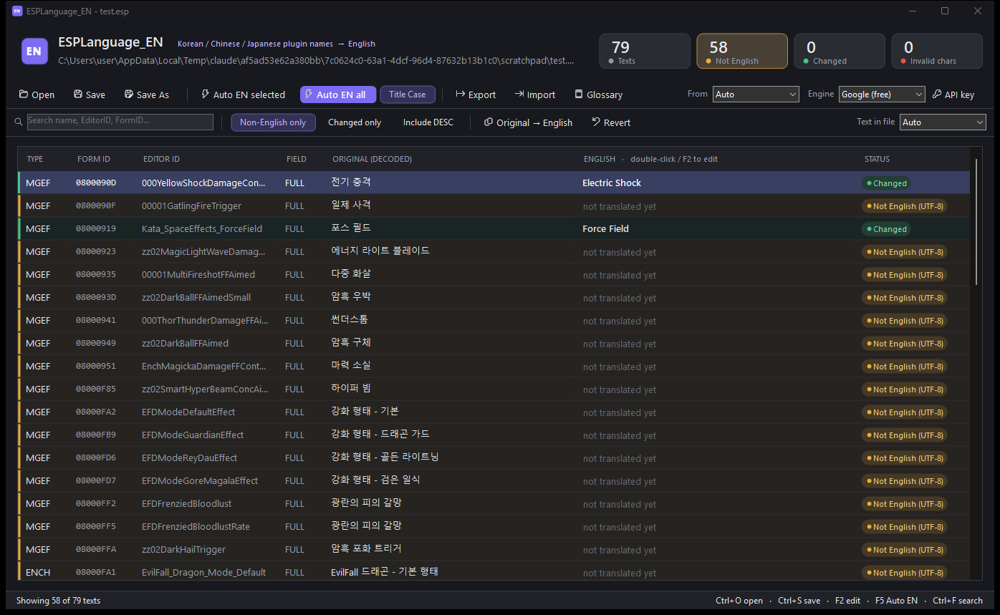

# ESPLanguage_EN

Translate the item / spell / NPC names inside Skyrim SE plugins (.esp / .esm / .esl) from Korean, Chinese or Japanese to English.

Made for mods whose names show up like `벚꽃 ë°¤ì˜...` in xEdit and as empty boxes in an English game.
That text is Korean / Chinese / Japanese stored as UTF-8 (or another code page). ESPLanguage_EN decodes it,
translates it, and writes plain English back into the plugin.

```
(lilyirm) 벚꽃 ë°¤ì˜ í™˜ìƒ ê°€ë°œ 1      <- what xEdit shows
(lilyirm) 벚꽃 밤의 환상 가발 1              <- ESPLanguage_EN "Original"
(lilyirm) Cherry Blossom Night Fantasy Wig 1   <- "English" after Auto EN
```



[ภาษาไทยอยู่ด้านล่าง](#ภาษาไทย)

---

## Download and install

1. Download `ESPLanguage_EN_v1.1.0.zip` from **[Releases](../../releases)**.
2. Unzip it anywhere, e.g. `C:\Modding\ESPLanguage_EN\`. Avoid `Program Files`: the tool writes backups and its settings next to the exe.
3. Run `ESPLanguage_EN.exe`. Nothing else is needed: the exe includes .NET.

Windows 10 or 11, 64-bit. If Windows SmartScreen warns about an unknown app, click *More info* -> *Run anyway*.

### With Mod Organizer 2
MO2 -> **Executables** (gear icon) -> **+** -> *Add from file* -> `ESPLanguage_EN.exe`.

Run it from MO2: the Open dialog then sees every plugin of the profile in `Data`.
Save writes the file in place, so the change stays in the mod's own folder, not in Overwrite.

## How to use

1. **Open** a plugin, or drag a .esp onto the window.
   - Amber rows are not English.
   - Green rows are changed.
   - Red rows contain characters an English game cannot show; they are not saved.
2. Translate:
   - **By hand**: double-click, press F2 or just start typing on a row.
   - **Auto EN selected** (F5) or **Auto EN all**: only the foreign part is translated. `(lilyirm)`, numbers and `EvilFall` stay as they are.
3. **Save** (Ctrl+S). The old file is copied to `backups\` next to the exe first.

Close xEdit and the game before saving a plugin they have open.

### The window
| Part | What it does |
|---|---|
| Cards at the top | Count of texts / not English / changed / invalid. Click *Not English* or *Changed* to filter. |
| Top bar, left | Open, Save, Save As · Auto EN selected / all · Export / Import TSV · Glossary |
| Top bar, right | **Engine** used by Auto EN, and **Settings** |
| Second bar | Search, filters (Non-English only, Changed only, Include DESC), Original → English, Revert |
| Status bar, right | The engine Auto EN will use: green ● = ready, amber ○ = not set up yet (click it to open its settings) |

Export / Import save the visible rows as a TSV file, translate the English column anywhere (Excel, ChatGPT, Claude...) and read it back. Rows match by FormID + field.
`glossary.txt` holds your own words (`가발 = Wig`), used before any engine; Notepad opens it and the glossary is reloaded when you come back to the window. Engine results are kept in `translation_cache.txt`, so a name is never translated twice.

### Settings
One page per topic. Everything is saved in `ESPLanguage_EN.ini` next to the exe.

| Page | What is on it |
|---|---|
| **General** | Engine for Auto EN · Translate from (Auto picks Korean / Japanese / Chinese by script) · Title Case · Text in file (decoding; *Auto* = UTF-8, then 949 / 936 / Big5 / 932) · Include DESC · buttons that open glossary.txt, the cache and the backups folder |
| **Claude** | API key, model |
| **Local AI** | Server URL (presets for Ollama and LM Studio), model, Find models |
| **NLLB-200** | Server URL, server folder and a **Start server** button |
| **DeepL** | API key (its own; not shared with Google Cloud) |
| **Google Cloud** | API key |
| **Google (free)** | nothing to set |

Every engine page has **Test** (translates `벚꽃 밤의 환상 가발` with the values on the page, before you save) and **Use this engine**.
Settings from 1.1.0 are moved over automatically.

## Translation engines

| Engine | Cost | Notes |
|---|---|---|
| **Claude** | paid per use, small for names | Anthropic's Claude: the best quality for game names. Key from [console.anthropic.com](https://console.anthropic.com) -> API keys, pasted in **Settings → Claude**. Model: `claude-opus-5-5` (default, best) or `claude-haiku-5-5` (much cheaper). |
| **Local AI** | free, offline | Qwen / Llama on your own PC through Ollama or LM Studio. Best free choice if you have a GPU. |
| **NLLB-200** | free, offline | Meta's translation model through the NLLB server below. Fast, but literal. |
| **DeepL** | free up to 500,000 characters / month | Sign up for *DeepL API Free* at deepl.com; the key ends with `:fx`. |
| **Google Cloud** | paid after the free tier | Cloud Translation API key. |
| **Google (free)** | free | No key, but Google often refuses automated requests (error 429). |

### Local AI with Ollama (Qwen / Llama)
1. Install Ollama from [ollama.com](https://ollama.com).
2. In a terminal: `ollama pull qwen2.5:7b`
   - About 4.7 GB, needs roughly 8 GB of VRAM.
   - `qwen2.5:14b` is better with 16 GB+ of VRAM; `qwen2.5:3b` suits weak PCs.
3. In ESPLanguage_EN: **Settings → Local AI** -> preset **Ollama** -> **Find models** -> pick the model -> **Test** -> **Use this engine** -> **Save**.

**LM Studio**: load a model, then Developer -> *Start server*, URL `http://localhost:1234/v1`. llama.cpp `llama-server`, Jan and other servers with `/v1/chat/completions` work too.

Qwen 2.5 is a good pick for game item names: it understands the context.

### Local AI with Meta NLLB-200
NLLB-200 is a translation-only model (licence CC-BY-NC 4.0, non-commercial). [tools/nllb_server.py](tools/nllb_server.py) runs it behind the same API as Ollama.

1. Install Python 3.10–3.12 from python.org (tick *Add to PATH*).
2. Run [tools/install_nllb.bat](tools/install_nllb.bat). It installs into `E:\nllb`; to choose another folder: `install_nllb.bat D:\nllb`. Without an NVIDIA GPU: `install_nllb.bat D:\nllb cpu`.
3. Run `start_nllb.bat` in that folder.
   - The first start downloads the model. Wait for `Ready`.
   - Smaller model: `start_nllb.bat --model facebook/nllb-200-distilled-1.3B`.
4. In ESPLanguage_EN: **Settings → NLLB-200** -> Server folder = the install folder (e.g. `E:\nllb`). From then on **Start server** there starts it. Wait for `Ready` in its window -> **Test** -> **Use this engine** -> **Save**.

| Model | Download | VRAM (fp16) |
|---|---|---|
| `facebook/nllb-200-3.3B` (default) | 17.6 GB | ~7 GB |
| `facebook/nllb-200-distilled-1.3B` | 5.5 GB | ~3 GB |
| `facebook/nllb-200-distilled-600M` | 2.5 GB | ~1.5 GB, or CPU |

**Is it running? How do I stop it?** The server holds about 7 GB of GPU memory while it runs.
- **Settings → NLLB-200** shows *Running* (model, device, minutes idle) or *Not running*, with **Start server**, **Stop server** and **Check**.
- `stop_nllb.bat` (in the install folder) stops it: it asks the server to stop, and if the server does not answer it ends the `python` process that holds port 8000. Another program on that port is left alone.
- Closing the server window or pressing Ctrl+C in it also stops it.
- It **stops by itself after 30 minutes without use**. Change it: `start_nllb.bat --idle-minutes 60`, or `--idle-minutes 0` to never stop.
- Only one server can run per port: a second `start_nllb.bat` says so and exits before loading anything.

The first start loads the downloaded model (about 5 minutes for 3.3B) and saves a fp16 copy in `models\` (6.3 GB). Later starts load that copy in seconds; you can then delete the `hf\` folder to free 17 GB.

Tested on an RTX 4070 SUPER: 58 EvilFall Dragon names in 11 seconds. NLLB is fast and free but literal. It gets common words right (`Battle Suit`, `High Heels`, `Energy Light Blade`) and misses game terms (`일제 사격` -> "One Shot" instead of *Volley Fire*, `다리 방어구` -> "Bridge Defense" instead of *Leg Armor*). Add those words to `glossary.txt`; they are used before NLLB. For the best names use Claude or Qwen.

## Limits
- Edits names (FULL) and descriptions (DESC) only.
- Localized plugins, whose names live in `Strings\*.STRINGS`, are refused.
- Skyrim SE / AE plugins. Compressed records are supported.
- Tested: open + save unchanged gives a byte-identical file (EvilFall, UBE, USSEP 17 MB with 5,103 compressed records).

## Command line
```
ESPLanguage_EN.exe <plugin>                                   open in the window
ESPLanguage_EN.exe --auto-en <plugin> <out> [ko|zh-CN|ja]     translate every non-English FULL with the engine in the ini,
                                                              write <out> and <out>.log.txt
ESPLanguage_EN.exe --test <plugin> <report.txt>               read / rebuild check, lists non-English texts
ESPLanguage_EN.exe --screenshots <folder>                     the Settings pages as PNG files (no window)
```

## Build from source
Needs the .NET 8 SDK. Run `build.bat`. It writes:
- `ESPLanguage_EN.exe`: self-contained single file.
- `release\ESPLanguage_EN_v<version>.zip`: exe + README + glossary.

Source code is in `src/` (C# WinForms, no external packages).

---

## ภาษาไทย

โปรแกรมแปลชื่อไอเทม เวท และ NPC ในไฟล์ปลั๊กอิน Skyrim SE (.esp / .esm / .esl) จากภาษาเกาหลี จีน หรือญี่ปุ่น เป็นภาษาอังกฤษ

ใช้กับมอดที่ชื่อขึ้นเป็นอักษรเพี้ยน เช่น `벚꽃 ë°¤ì˜...` ใน xEdit หรือขึ้นเป็นกล่องสี่เหลี่ยมในเกม

### ติดตั้ง
1. ดาวน์โหลด `ESPLanguage_EN_v1.1.0.zip` จากหน้า **[Releases](../../releases)**
2. แตกไฟล์ไว้ที่ไหนก็ได้ เช่น `C:\Modding\ESPLanguage_EN\` (อย่าวางใน `Program Files` เพราะโปรแกรมต้องเขียนไฟล์สำรองและไฟล์ตั้งค่าไว้ข้างตัว exe)
3. เปิด `ESPLanguage_EN.exe` ได้เลย ไม่ต้องติดตั้ง .NET เพิ่ม

ถ้า Windows ขึ้นเตือน SmartScreen ให้กด *More info* → *Run anyway*

**ใช้กับ MO2:** MO2 → Executables (รูปเฟือง) → + → Add from file → เลือก `ESPLanguage_EN.exe` แล้วเปิดโปรแกรมผ่าน MO2 ตอน Save ไฟล์จะอยู่ในโฟลเดอร์ของมอดนั้นเอง ไม่ไปตกใน Overwrite

### วิธีใช้
1. กด **Open** หรือลากไฟล์ .esp มาวางในหน้าต่าง
   - แถวสีส้ม: ยังไม่ใช่ภาษาอังกฤษ
   - แถวสีเขียว: แก้แล้ว
   - แถวสีแดง: มีตัวอักษรที่เกมแสดงไม่ได้ จะไม่ถูกบันทึก
2. แปลได้ 2 แบบ:
   - **แก้เอง:** ดับเบิลคลิก กด F2 หรือเริ่มพิมพ์ที่แถวนั้นได้เลย
   - **อัตโนมัติ:** กด **Auto EN selected** (F5) หรือ **Auto EN all** โปรแกรมแปลเฉพาะส่วนที่เป็นภาษาต่างประเทศ ส่วน `(lilyirm)` และตัวเลขคงไว้ตามเดิม
3. กด **Save** (Ctrl+S) โปรแกรมจะสำรองไฟล์เดิมไว้ในโฟลเดอร์ `backups` ก่อนเขียนทับ

ต้องปิด xEdit และเกมก่อนกด Save ไฟล์เดียวกัน

### เลือกตัวแปล (Engine)
กด **Settings** แล้วเลือกหัวข้อทางซ้าย: **General** คือการตั้งค่าทั่วไป ส่วนหัวข้ออื่นเป็นของตัวแปลแต่ละตัว แต่ละหน้ามีปุ่ม **Test** (ลองแปลทันทีด้วยค่าที่กรอกอยู่ ไม่ต้อง Save ก่อน) และ **Use this engine** (ใช้ตัวนี้กับ Auto EN)
แถบล่างขวาของหน้าต่างหลักบอกว่าตอนนี้ใช้ตัวแปลไหน จุดเขียว ● คือพร้อมใช้ จุดส้ม ○ คือยังไม่ได้ตั้งค่า (คลิกเพื่อไปตั้งค่าได้เลย)

- **Claude:** คุณภาพดีที่สุดสำหรับชื่อไอเทมในเกม แต่เสียค่าใช้จ่ายตามการใช้งาน (สำหรับชื่อสั้นๆ ถือว่าน้อย)
  1. สร้าง API key ที่ console.anthropic.com → API keys
  2. ใส่ key ใน **Settings → Claude**
  3. เลือกโมเดล: `claude-opus-5-5` (ค่าเริ่มต้น ดีที่สุด) หรือ `claude-haiku-5-5` (ถูกกว่ามาก)
- **Local AI (แนะนำ ถ้ามีการ์ดจอ):** ฟรีและใช้ได้แบบออฟไลน์
  1. ติดตั้ง Ollama จาก ollama.com
  2. เปิด terminal แล้วสั่ง `ollama pull qwen2.5:7b`
  3. **Settings → Local AI** → กดปุ่ม **Ollama** → **Find models** → เลือกโมเดล → **Test**
- **NLLB-200 ของ Meta:** ฟรี ออฟไลน์ และเร็ว แต่แปลตรงตัว
  1. ติดตั้ง Python 3.10–3.12 แล้วรัน `tools\install_nllb.bat`
  2. **Settings → NLLB-200** → ตั้ง Server folder เป็นโฟลเดอร์ที่ติดตั้ง (เช่น `E:\nllb`) → กด **Start server**
  3. รอหน้าต่างเซิร์ฟเวอร์ขึ้นว่า `Ready` แล้วกด **Test**
  4. **ดูว่ายังรันอยู่ไหม / หยุดยังไง:** เซิร์ฟเวอร์ใช้หน่วยความจำการ์ดจอประมาณ 7 GB ตลอดเวลาที่รัน
     - หน้า **Settings → NLLB-200** บอกว่า Running หรือ Not running และมีปุ่ม **Stop server**
     - หรือดับเบิลคลิก `stop_nllb.bat` ในโฟลเดอร์ที่ติดตั้ง หรือปิดหน้าต่างเซิร์ฟเวอร์ / กด Ctrl+C ในหน้าต่างนั้น
     - ถ้าไม่มีการใช้งาน 30 นาที เซิร์ฟเวอร์จะหยุดเอง (เปลี่ยนได้ด้วย `start_nllb.bat --idle-minutes 60` หรือ `0` เพื่อไม่ให้หยุดเอง)
     - เปิดซ้อน 2 ตัวไม่ได้ ตัวที่สองจะแจ้งว่ามีเซิร์ฟเวอร์รันอยู่แล้ว และปิดตัวเองก่อนโหลดโมเดล
- **DeepL:** ฟรีเดือนละ 500,000 ตัวอักษร สมัคร DeepL API Free ที่ deepl.com แล้วใส่ key ใน **Settings → DeepL** (key ของ DeepL กับ Google Cloud แยกกันแล้ว)
- **Google (free):** ไม่ต้องใช้ key แต่มักโดน Google บล็อก (ขึ้น error 429)
- **Export / Import:** ส่งออกเป็นไฟล์ TSV ไปแปลที่ไหนก็ได้ (Excel, ChatGPT, Claude) แล้วนำเข้ากลับ

`glossary.txt` ใช้ใส่คำแปลของเราเอง เช่น `가발 = Wig` โปรแกรมจะใช้คำในไฟล์นี้ก่อนตัวแปลทุกตัว

### ข้อจำกัด
- แก้ได้เฉพาะชื่อ (FULL) และคำอธิบาย (DESC)
- ปลั๊กอินแบบ localized ที่เก็บชื่อไว้ในไฟล์ `.STRINGS` แก้ไม่ได้
